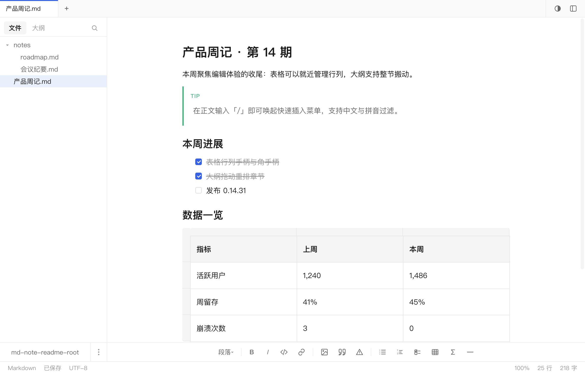
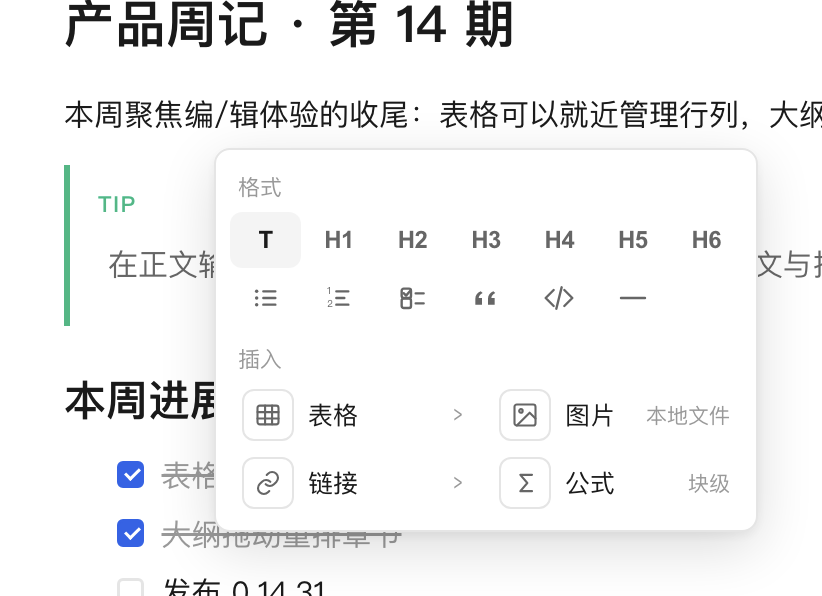
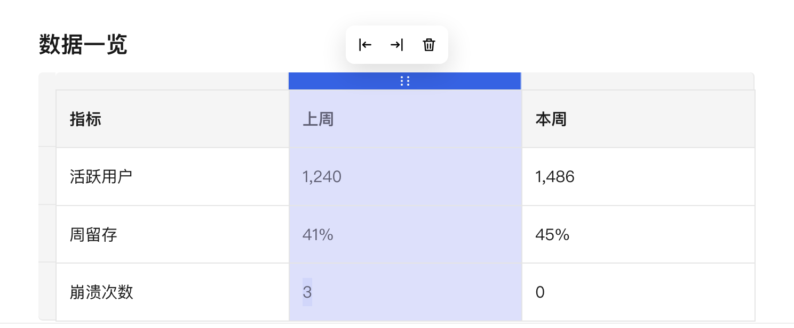
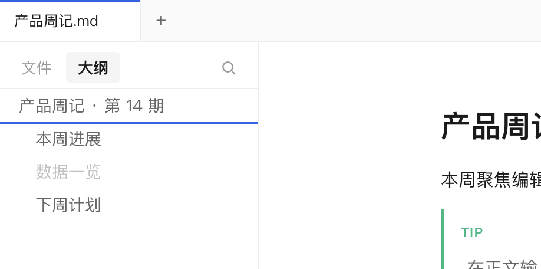

# MarkdownNote

跨平台（macOS + Windows）本地 Markdown 编辑器，所见即所得。纯本地单机应用：无登录、无云同步、无后端，文档始终留在你的磁盘上。



## 特色功能

### 斜杠快速插入

正文里敲一个 `/` 就能唤起插入菜单，中文名或拼音缩写都能过滤。表格直接在菜单里扫选行列数，链接展开「文字 + 地址」表单，图片走系统文件选择器并自动存到文档同级 `img/`；常驻条目会记住最近使用。底部工具栏的表格按钮走同一套行列网格，选几行几列就插几行几列。



### 表格就近编辑

鼠标移到表格上才会浮出行列手柄，阅读时完全不打扰。点列手柄选中整列、点行手柄选中整行，工具条按方向给出「插左 / 插右」或「插上 / 插下」与「删除」；点左上角角手柄可一键选中整张表。手柄与表格严丝合缝，工具条浮在表格上方不遮挡内容。



### 大纲拖动重排

侧栏大纲随标题实时更新。按住标题拖动，就能把该标题连同下面的子标题与正文整节搬到目标位置，落点有插入指示线——整理长文档不必再剪切粘贴。



## 其他能力

- **所见即所得**：输入即渲染，无需分屏预览；`Cmd/Ctrl + /` 随时切到源码模式
- **排版齐全**：一至六级标题、列表与任务列表、引用、脚注、下划线、删除线、警告框（5 种类型）、`[TOC]` 目录、YAML Front Matter
- **代码与公式**：代码块语法高亮（Shiki，28 种语言，明暗自适应）、KaTeX 行内 / 块级公式、Mermaid 图表
- **图片**：粘贴、拖入、本地选择三种方式，自动落到文档同级 `img/` 并写相对路径
- **多标签**：同时编辑多个文档，标签脏点提示，支持双击重命名；右键可关闭其他 / 左侧 / 右侧、复制路径、在文件管理器中显示；`Shift + Cmd/Ctrl + T` 恢复刚关掉的标签
- **文件树与搜索**：懒加载目录树、文件夹内全文搜索（大小写 / 全单词 / 正则），点击结果直达对应行；搜索可取消，结果触达上限时明确提示可能不完整
- **文档检查**：只读检查空链接与失效本地图片，点击问题可跳到对应行；帮助菜单提供可选语法示例
- **导出**：PDF / HTML / Word 一键导出，公式与图片离线可看
- **保存可靠**：原子写入（临时文件 → fsync → 替换），崩溃不产生截断文档；磁盘文件被外部改动时暂停自动保存、不静默覆盖；自动保存可关闭或改成 1 / 1.5 / 3 秒；状态栏显示正在保存 / 已保存 / 未保存成功
- **编码兼容**：自动识别 UTF-8（含 BOM）/ UTF-16 / GBK，保存统一转 UTF-8
- **上手无负担**：会话恢复、窗口尺寸与偏好记忆、明暗主题（可跟随系统外观）、中文输入法适配

## 技术栈

Electron + React 18 + TypeScript + Vite（electron-vite），编辑器内核为 Milkdown（ProseMirror + remark），npm workspaces 管理 Monorepo。

## 开发

```bash
npm install          # 安装依赖
npm run dev          # 开发模式（热更新）
npm run build        # 构建产物
npm test             # 单元测试 + 菜单校验 + 退出流程 + Electron 端到端测试（需先 build）
```

## 下载

安装包统一从 [Releases](https://github.com/jxwuqingyan/ai-md-editor/releases) 下载：macOS 取 `MarkdownNote-<版本>-arm64.dmg`（Apple Silicon），Windows 取 `MarkdownNote.Setup.<版本>.exe`。包为 ad-hoc 签名、未公证，macOS 首次打开请右键→打开，或执行 `xattr -dr com.apple.quarantine /Applications/MarkdownNote.app`。

## 打包

安装包不在本机产出，全部由 CI 在打 `v*` tag 时构建并挂到 Release。CI 只在**打 `v*` tag**（或手动 `workflow_dispatch`）时触发，提交到 main 不产生运行记录——日常改动的验证靠本地 `npm test`。公开仓库使用 GitHub 托管 runner 不消耗额度。

job 顺序是 `plan → test → build`：`plan` 校验 tag 与包版本一致并生成矩阵，`test` 跑 macOS 完整测试与 Windows 单元/菜单校验，`build` 才打包并发 Release。**测试不过就不打包、不发版**。

默认只打 **macOS arm64 + Windows x64**，需要 Intel 包时手动触发并选 `targets=all`：

```bash
gh workflow run build.yml --ref main -f targets=all   # default / mac-arm64 / win-x64 / all
```

本地出包只在 CI 不可用或排查打包问题时使用（流程与坑见 [技术方案 10.5](./docs/技术方案文档.md)），产物落在 `apps/desktop/release/`，用完清掉：

```bash
npm run build
cd apps/desktop
env -u NODE_OPTIONS -u ELECTRON_RUN_AS_NODE CSC_IDENTITY_DISABLED=1 \
  ../../node_modules/.bin/electron-builder --mac --arm64 --dir
cd ../..
bash scripts/make-dmg.sh <版本号> arm64
```

### 发布新版本

发版按需进行——日常提交只推 `main`，不升版本号、不打 tag；确定要发版时再走这四步：

1. 把版本号统一改到 **5 处**：`package.json`、`apps/desktop/package.json`，以及 `package-lock.json` 的 `version` / `packages[""].version` / `packages["apps/desktop"].version`
2. 自检：`npm run release:check -- v1.0.1`
3. 提交并推送 `main`
4. `git tag v1.0.1 && git push origin v1.0.1` —— CI 会先校验 tag 与包版本一致，再跑测试、打包并创建 Release

第 2 步的校验在 CI 里也会跑（`plan` job），版本对不上时打包阶段整体跳过，不会产出「标签 1.0.1、包名 1.0.0」的错位附件。

## 版本与文档

- 功能更新记录见 [CHANGELOG.md](./CHANGELOG.md)
- [技术方案文档](./docs/技术方案文档.md)
- [UI-UX 设计规范](./docs/UI-UX设计规范.md)
